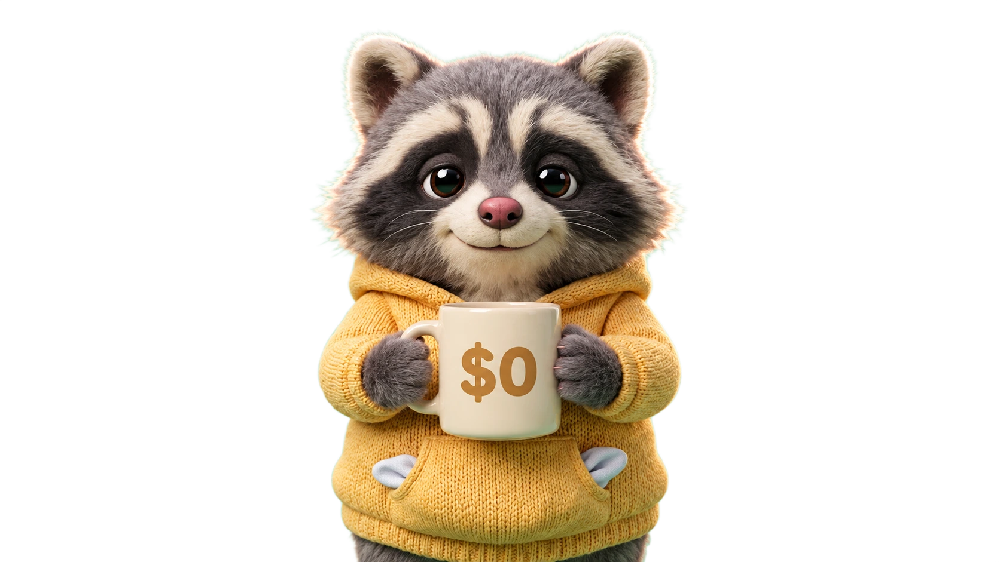

<div align="center">



# unpaid-devs

```bash
$ whoami
unpaid-devs

$ cat salary.txt
$0_
```

**open source projects, built for earth, paid in coffee.**

[](https://github.com/unpaid-devs)
[](https://github.com/unpaid-devs)
[](https://github.com/unpaid-devs)

</div>

---

## 🦝 Who we are

We're a small group of developers who build things because we want to, not because someone's paying us (clearly). Some projects solve real problems. Some exist because it was 2 AM and the idea seemed great. All of them are open source.

## 🛠️ What we build

Anything that catches our interest, really. You'll find stuff like:

- **Tools and utilities** that make dev life a little less painful
- **Bots and automations** for the platforms we actually use
- **Web and mobile apps** that started as "wouldn't it be cool if..."
- **Experiments** that may or may not work (we'll find out together)

## 📦 Featured projects

| Project | Description | Stack |
|---------|-------------|-------|
| [file-icons](https://github.com/unpaid-devs/file-icons) | File type icons for React. Inline SVG, no icon library, no image files. Only peer dependency is React. | Typescript |

> More coming whenever motivation and free time align.

## 🧰 Our usual stack

[](https://skillicons.dev)

...but honestly, that's just what we reach for most. Our real stack looks more like this:
 
```js
const ourStack = {
  languages: "whatever the project needs",
  frameworks: "the one with the best docs at 2 AM",
  database: "we've met most of them",
  learningCurve: "we'll climb it",
  limitations: null,
  budget: 0,
};
```
 
New language? New framework? Some tool nobody's heard of? If it solves the problem, we'll learn it. Being unpaid means nobody can tell us what stack to use. 🦝

## 🤝 Contributing

Found a bug? Got an idea? Want to join the unpaid workforce?

- Open an **issue** on any repo
- Send a **pull request** (we review them, eventually)
- Start a **discussion** if you just want to talk

Every contribution is welcome, from typo fixes to whole new features. Pay is the same for everyone ($0,000) 😌

## 👥 The team

|  |  |
|:---:|:---:|
| [**@BlackAmda**](https://github.com/BlackAmda) | [**@sasmeee**](https://github.com/sasmeee) |

## ☕ Support us

We're unpaid, not uncaffeinated. Our projects run on coffee, and our coffee runs on you.

`[DONATION LINK NOT READY YET]`

Every coffee you send gets turned directly into code (and the occasional 2 AM bug). Can't spare a coffee? That's fine too:
 
- ⭐ **Star** the repos you find useful
- 🔁 **Share** them with people who might need them
- 🐛 **Report** bugs so we can fix them
Technically still $0 salary. Coffee doesn't count. 🦝

---

<div align="center">

<sub>Built with ☕ and zero budget in 127.0.0.1🌏</sub>

</div>
